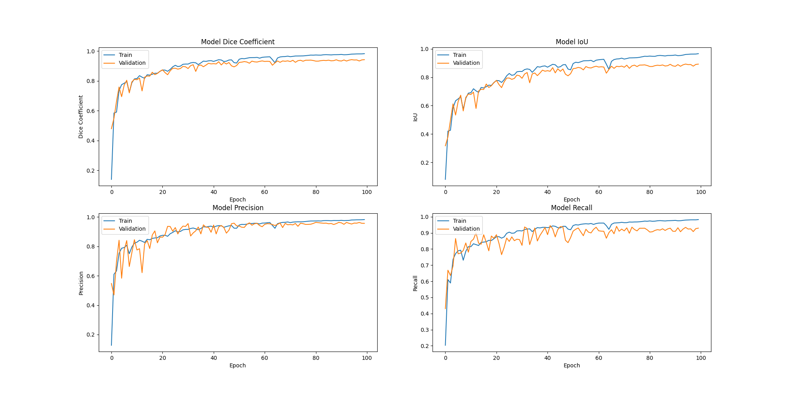

# Melt-Pool Segmentation with Attention U-Net

This repository contains code for automated melt-pool segmentation from high-speed X-ray radiography images. It uses an Attention U-Net built with TensorFlow/Keras to extract melt-pool boundaries frame by frame.

## Background
The code comes from M.Sc. research on melt-pool monitoring in laser material processing using high-speed synchrotron X-ray radiography. The goal is automated, frame-by-frame extraction of melt-pool boundaries to better understand and control the process.

## Method
Defined in `src/train_unet.py`:

* **Architecture:** Attention U-Net with four encoder levels (16, 32, 64, 128 filters) and a 256-filter bottleneck. Each level uses two 3×3 convolutions (ReLU, He-normal initialization) followed by 2×2 max pooling. The decoder uses 2×2 upsampling and concatenates each upsampled feature map with an attention-gated skip connection.
* **Input:** Single-channel (grayscale) images resized to 1200×768 (shape `768, 1200, 1`). Images and masks are each divided by their maximum value.
* **Output:** Single-channel probability map with a sigmoid activation. At prediction time it is thresholded at 0.5.
* **Loss:** Binary cross-entropy.
* **Training setup:** Adam optimizer (learning rate 1e-4), batch size 10, 100 epochs, 10% validation split, `ReduceLROnPlateau` callback on validation Dice.
* **Metrics:** Dice coefficient, IoU, precision and recall.

## Repository Structure
```text
.
├── assets/
│   └── meltpool_segmentation_model34_metrics_plot.png  # Training/validation curves
├── src/
│   ├── train_unet.py      # Builds and trains the Attention U-Net, saves the model and a metrics plot
│   ├── predict_unet.py    # Runs a trained model on PNG images, saves mask overlays and per-image metrics
│   ├── sorting_image.py   # Renames PNG files in a folder to zero-padded sequential names (0001.png, ...)
│   └── tif_to_png.py      # Converts TIFF images to PNG
├── requirements.txt
├── LICENSE                # MIT License
└── README.md
```

Data, masks, predictions and model weights (`.h5`) are not included in the repository.

## Requirements
Python with the packages in `requirements.txt` (NumPy, TensorFlow ≥ 2.10, scikit-image, scikit-learn, Matplotlib, Pillow). The training script places the model on `/GPU:0`.

```bash
git clone https://github.com/Farshadmhd/melt-pool-segmentation.git
cd melt-pool-segmentation
python -m venv venv
source venv/bin/activate  # On Windows: venv\Scripts\activate
pip install -r requirements.txt
```

## Usage

### 1. Preprocessing
`tif_to_png.py` and `sorting_image.py` use folder paths set inside the scripts. Edit `source_folder` / `target_folder` and `directory` before running.

```bash
python src/tif_to_png.py
python src/sorting_image.py
```

### 2. Training
Training images and masks must be PNG files with matching file names in two separate folders.

```bash
python src/train_unet.py \
    --train-path "/path/to/Train_orginal" \
    --label-path "/path/to/Mask" \
    --model-save-path "/path/to/model.h5"
```

The model is saved to `--model-save-path`, and a plot of the training/validation metrics is saved next to it as `<model name>_metrics_plot.png`.

### 3. Prediction
```bash
python src/predict_unet.py \
    --model-path "/path/to/model.h5" \
    --source-folder "/path/to/images" \
    --output-folder "/path/to/Prediction"
```

For each PNG in the source folder, the script saves `overlay_<filename>` (predicted mask in red over the input image) to the output folder. It also writes per-image precision, recall and IoU to `metrics.txt` and prints the averages. Note: these values compare the prediction with a thresholded version of the input image (original_image > 0), not with a ground-truth mask, so they are a consistency check and not accuracy scores.

## Results
Training and validation curves (Dice, IoU, precision, recall) over 100 epochs for the model saved as `meltpool_segmentation_model34`:


